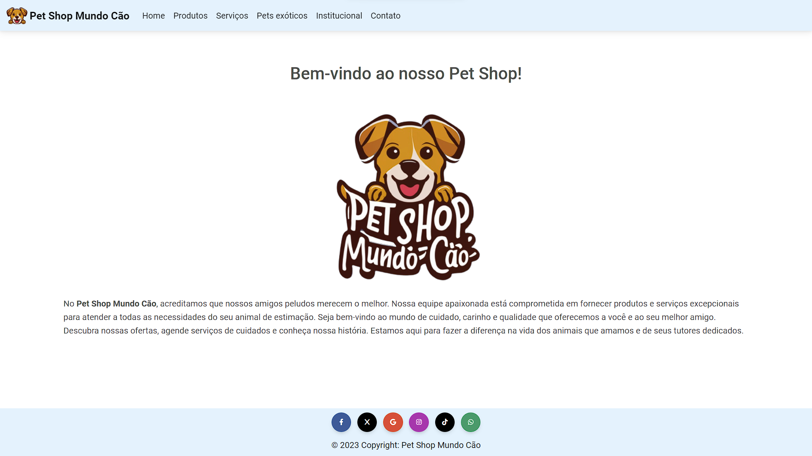

# Proz Project – Class 15 | Group

The objective of this project is to develop an e-commerce website with a pet shop theme. The website’s resources and functionalities will be continuously updated in each sprint, reflecting the team’s progress throughout the course

### Alexandre Silberstein

